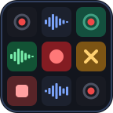

<p align="center">
  
</p>

# StreamDeck Sampler

A sampler plugin for the Stream Deck, inspired by the GoXLR. Hold a key to record a sample, press it to play it back.

## Features

- Hold any empty pad to record
- Recordings get trimmed of silence and loudness-normalised, so everything plays at a similar volume
- Multiple samples per pad, played in order or at random, each with its own trim
- Six playback modes: Play/Next, Play/Stop, Play/Fade, Hold, Hold/Fade and Loop
- Pre-buffered recording, so you can catch audio from *before* you pressed the key (up to 30 s)
- Pick your own capture and playback devices
- Add and Clear buttons for recording into, or wiping, any pad
- Keys show waveforms, play progress, a record timer and which mode you've armed

---

## Requirements

Works with OpenDeck and the official Stream Deck application.

| Platform | Status |
| --- | --- |
| Linux | Tested, mostly with OpenDeck |
| Windows | Untested, should work |
| macOS | Untested, might work (see below) |

**macOS:** Recording needs microphone permission, and it's not clear how that works for a Stream Deck plugin. It
may need to be granted to the Stream Deck app or OpenDeck instead of the plugin. If you try it, please open an
issue and say how it went.

## Installation

Grab the `.sdPlugin` file from the [Releases](/releases) page, then:

| Platform | Steps |
| --- | --- |
| Windows (official Stream Deck app) | Double-click the downloaded file |
| Linux / OpenDeck | `Plugins` → `Install From File`, then pick the downloaded file |

---

## Actions

| Action | What it does |
| --- | --- |
| Sample Pad | One key is one pad |
| Add to Sample Pad | Arms "record into any pad" |
| Clear Sample Pad | Arms "clear any pad" |

### Sample Pad

A pad holds a stack of samples and plays them based on its **Function**. If a pad is empty, it's a record pad:
hold to record, release to save.

#### Playback modes

| Function | Badge | On press | While held | On release |
| --- | --- | --- | --- | --- |
| Play / Next | `NEXT` | Plays the next sample | - | - |
| Play / Stop | `PLAY/STOP` | Plays the next sample, press again to stop | - | - |
| Play / Fade | `PLAY/FADE` | Plays the next sample, press again to fade out | - | - |
| Hold to play | `HOLD` | Starts the next sample | Keeps playing | Stops |
| Hold to play, fade out | `HOLD/FADE` | Starts the next sample | Keeps playing | Fades out |
| Loop | `LOOP` | Starts looping the next sample, press again to stop | - | - |

Which sample is "next" depends on the pad's **Order** setting. **In order** goes through the stack and wraps
around, **Random** picks a different one each time.

#### Recording

- On an empty pad, hold to record and release to save. The recording gets added to the pad.
- If the **Add** button is armed, you can hold *any* pad to record into it (see
  [Add to Sample Pad](#add-to-sample-pad)).
- Recordings include audio from before you pressed the key, based on the **Pre-buffer** setting.
- Silence at the start and end is trimmed off, and recordings that are basically silent get thrown away.

#### What the key shows

| State | Looks like | Means |
| --- | --- | --- |
| Empty | Dark, red dot, **HOLD TO RECORD** | No samples yet, hold to record one |
| Idle | Blue, with name, waveform, mode badge and `xN` sample count | Ready to play |
| Playing | Green, waveform with a progress cursor | A sample is playing |
| Recording | Red, blinking REC dot and `m:ss` timer | Recording |
| Clear armed | Amber, **CLEAR?** | Press this key to clear it |
| Add armed | Teal, **ADD?** | Hold this key to record into it |

### Add to Sample Pad

Press to arm it, press again to cancel. While it's armed, every pad shows **ADD?** and the button itself shows
*Pick a Pad*. Hold a pad to record, and when you let go the recording is added to the end of that pad's samples.
Pads won't play while Add is armed, presses only record.

### Clear Sample Pad

Press to arm it, press again to cancel. While it's armed, every pad shows **CLEAR?** and the button shows
*Pick a Pad*. Press a pad to stop it and remove all its samples. The files stay on disk.

---

## Settings

Open the property inspector on any Sample Pad key. There are three sections: Pad, Samples and Global Settings.

### Pad

| Setting | Description |
| --- | --- |
| Name | Label shown on the key |
| Function | Playback mode, see [Playback modes](#playback-modes) |
| Order | In order or Random |

### Samples

Each pad has an ordered list of samples, and each sample has its own trim. You can use the same file on as many
pads as you like, and removing a sample from a pad never deletes the file.

| Control | Description |
| --- | --- |
| Trim slider | Drag the two thumbs to set the start and end. The dimmed part isn't played. |
| Gain badge | The volume adjustment applied to the sample (e.g. `x1.24`) so it matches the rest. Set automatically. |
| ✕ | Removes the sample from this pad |
| Add | Pick a file from your samples folder, then press **Add** to put it on this pad |
| ↻ | Rescans the samples folder for new files |

### Global settings

These apply to every pad.

| Setting | Description |
| --- | --- |
| Record from | The capture device: a mic or any other input. Output monitors are listed separately where the system can identify them (currently PulseAudio / PipeWire on Linux) and record whatever a given output is playing. On other systems, anything the OS exposes as an input, virtual devices included, shows up under Inputs. |
| Play To | The playback device |
| Pre-buffer | How much audio from *before* you press a pad ends up in the recording (0 to 30 s) |
| Samples Folder | Where recordings are saved and where the **Add** dropdown looks for files, subfolders included. Defaults to `~/.local/share/sd-sampler`. Supports `wav`, `ogg`, `flac` and `mp3`. |

---

## Routing audio

Out of the box, samples play to your default output and recordings come from your default input. If you're
streaming or on a call, you'll probably want the samples to go out through your microphone so other people hear
them too.

The usual way to do that is with a mixer that has virtual channels, and then point the plugin at it:

- **Play To:** Choose a virtual output channel on your mixer. From there you can send the samples to your
  headphones, your stream mix and your mic channel separately.
- **Record from:** Choose a mixer channel, virtual device or output monitor to capture something other than the
  default input, like game audio, music, chat, or your mic with samples mixed in.

Tools that can create virtual channels and route between them should do the job:

| Tool | Platform | Notes |
| --- | --- | --- |
| [PipeWeaver](https://github.com/FrostyCoolSlug/pipeweaver) | Linux | Built on PipeWire and aimed at streaming and broadcasting. Still in heavy development. |
| [Elgato Wave Link 3](https://www.elgato.com/us/en/s/wave-link) | Windows, macOS | Free and works with any mic. Has a routing table with virtual channels and up to 5 output mixes. |
| [Voicemeeter](https://vb-audio.com/Voicemeeter/) | Windows | Virtual inputs and outputs with flexible routing |

---

## Building

Want to build it yourself? You'll need Rust, Node.js and `zip`. Then:

```bash
./build.sh --install   # build and install into OpenDeck, restart it afterwards
./build.sh --package   # build a .sdPlugin file in the project root (the default)
```

The script is Linux only. Windows and macOS builds come from the GitHub Actions workflow. Manual builds can be done,
but you'll have to read the Linux script.

## License

Copyright © 2026 Craig McLure, see [LICENSE](LICENSE).